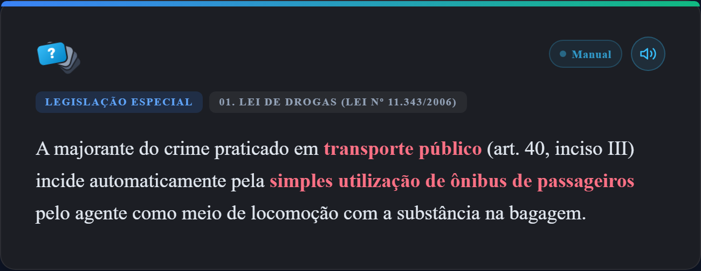
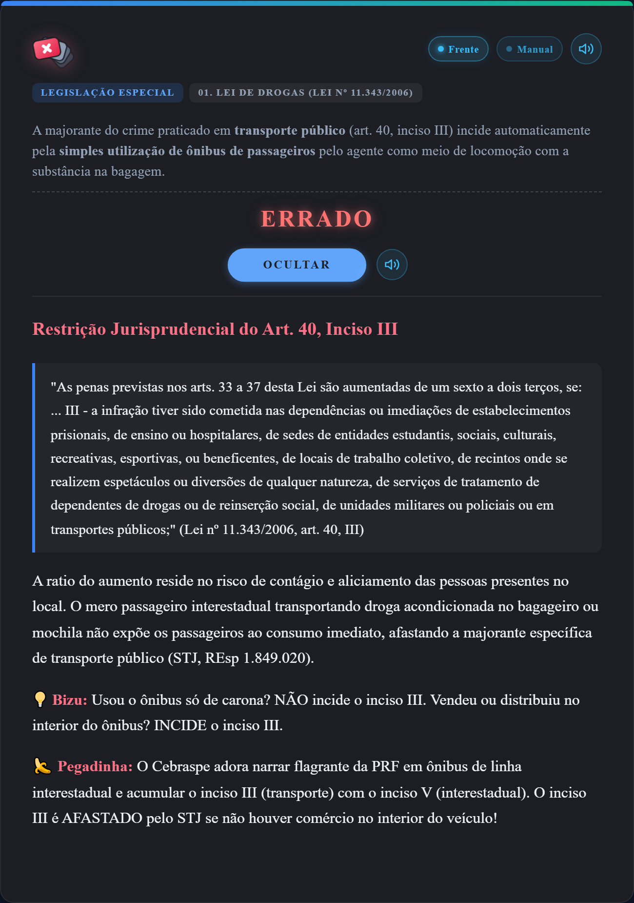

# 🗂️ Anki Templates Engine — Tripla Blindagem

> **Motor visual, interativo e autossincronizável para cartões do Anki (Desktop & AnkiDroid).**  
> Desenvolvido para o modelo **`Disciplina | Assunto | Certo ou Errado`**, garantindo atualização instantânea de layouts, scripts, atalhos e áudio neural **sem duplicar modelos (`Modelo+`)** e preservando 100% o agendamento de estudo dos alunos.

---

[-success?style=flat-square&logo=github)](https://gilsonnogueira.github.io/anki-templates/version.json)
[](https://apps.ankiweb.net/)
[](https://github.com/ankidroid/Anki-Android)
[](./version.json)
[](LICENSE)

---

## 📸 Demonstração Visual dos Cartões

### 1. Visão Geral: Frente e Verso do Cartão
A interface foi projetada com foco em **ergonomia cognitiva**, tipografia legível, contraste WCAG AAA e design tridimensional limpo.

| Frente do Cartão (`Frente.html`) | Verso com Gabarito (`Verso.html`) |
| :---: | :---: |
|  |  |
| *Tag de Disciplina/Assunto, Logo 3D azul com interrogação `?`, assertiva Cebraspe em destaque e barra de controles.* | *Badge dinâmico de gabarito (CERTO/ERRADO), assertiva com realce semântico e síntese executiva BLUF.* |

---

## ✨ Funcionalidades Interativas em Ação (GIFs)

### 🎴 1. Logo 3D com Flip Tridimensional e Feedback Instantâneo
A logo central reage dinamicamente ao avanço do cartão. Na frente, exibe o ícone de dúvida tridimensional (`?`). No verso, gira suavemente em 3D com animação elástica (*spring pop*), exibindo a insígnia de validação correspondente ao gabarito (`✓` para Certo, `✕` para Errado).

<div align="center">
  
  <p><em>Giro 3D da logo com efeito elástico e anel neon responsivo.</em></p>
</div>

---

### 👁️ 2. Alternância Rápida da Pergunta no Verso (Atalho `F` ou Botão)
Para revisões ultrarrápidas, o aluno pode ocultar ou exibir a assertiva da frente no verso com apenas um toque no botão **F** ou pressionando a tecla **`F`** no teclado. O estado de preferência é salvo instantaneamente para os próximos cards.

<div align="center">
  
  <p><em>Exibição e ocultação dinâmica da pergunta no verso via tecla F ou clique.</em></p>
</div>

---

### 📖 3. Sanfona Doutrinária BLUF / Mini-Aula (Atalho `X` ou Botão)
A explicação completa da questão (jurisprudência consolidada, artigos de lei e doutrina de apoio) fica compactada em uma sanfona elegante para não poluir a leitura do gabarito. Pressione a tecla **`X`** ou clique em **Explicar** para uma animação fluida de expansão:

<div align="center">
  
  <p><em>Expansão suave com formatação jurídica, artigos grifados e precedentes dos Tribunais Superiores.</em></p>
</div>

#### Detalhe da Explicação Expandida:
<div align="center">
  
</div>

---

## ⌨️ Atalhos de Teclado e Controles

O motor do template possui captura inteligente de eventos de teclado que não interfere com os atalhos nativos de resposta do Anki:

| Tecla / Atalho | Ação Executada | Descrição |
| :---: | :---: | :--- |
| <kbd>R</kbd> | **Repetir / Áudio** | Dispara o áudio neural do cartão (ou para o áudio se já estiver tocando). Pisca o indicador sonoro. |
| <kbd>F</kbd> | **Toggle Frente** | Oculta ou exibe a assertiva original da frente enquanto estiver revisando o verso. |
| <kbd>X</kbd> | **Explicar / Sanfona** | Abre ou fecha a mini-aula doutrinária com a fundamentação e jurisprudência completa. |
| <kbd>Espaço</kbd> | **Mostrar Resposta** | Comportamento padrão do Anki (vira o cartão da frente para o verso). |
| <kbd>1</kbd>, <kbd>2</kbd>, <kbd>3</kbd>, <kbd>4</kbd> | **Avaliar Card** | Responde o cartão (Errei, Difícil, Bom, Fácil) de acordo com o agendamento FSRS / SM-2. |

### Controles no Cabeçalho do Cartão:
- **Botão Áudio (Auto / Manual):** Alterna se o áudio neural deve iniciar automaticamente ao virar o cartão ou somente sob demanda do estudante.
- **Botão Modo Escuro / Claro / Auto:** Sincroniza com as preferências do sistema operacional ou permite fixação manual.
- **Suporte Mermaid Integrado:** Diagramas de fluxo e mapas mentais em sintaxe Mermaid são renderizados nativamente em gráficos SVG de alta resolução.

---

## 🛡️ Arquitetura de Tripla Blindagem (Zero Conflito `Modelo+`)

Tradicionalmente, atualizar templates de cartões compartilhados no Anki gera duplicações indesejadas (`Disciplina | Assunto | Certo ou Errado+`), forçando os alunos a reorganizarem seus baralhos manualmente. 

Nossa arquitetura resolve isso dividindo o sistema em **uma casca imutável (Frozen Shell)** e **um motor externo em camadas**:

```
+--------------------------------------------------------------------------+
|                        CARTÃO ANKI (FROZEN SHELL)                        |
|   <div id="anki-raw-fields" style="display:none !important;">...</div>    |
+--------------------------------------------------------------------------+
                                     │
                                     ▼
        ┌────────────────────────────────────────────────────────┐
        │   CAMADA 1: OFFLINE IMEDIATO (collection.media)        │
        │   • Lê _anki_estilo.css e _anki_scripts.js embutidos   │
        │   • Carrega em 0ms mesmo em modo avião                 │
        └────────────────────────────┬───────────────────────────┘
                                     │
                                     ▼
        ┌────────────────────────────────────────────────────────┐
        │   CAMADA 2: CACHE SÍNCRONO (localStorage)              │
        │   • Guarda em cache a última versão baixada            │
        │   • Zero 'Flash of Unstyled Content' (FOUC)            │
        └────────────────────────────┬───────────────────────────┘
                                     │
                                     ▼
        ┌────────────────────────────────────────────────────────┐
        │   CAMADA 3: AUTO-UPDATE SILENCIOSO (GitHub Pages CDN)  │
        │   • Busca silenciosa em background (HTTP GET)          │
        │   • Atualiza estilo.css e scripts.js em tempo real     │
        └────────────────────────────────────────────────────────┘
```

1. **Camada 1 — Offline Nativo Imediato (`collection.media`):**  
   Os arquivos `_anki_estilo.css` e `_anki_scripts.js` viajam dentro do arquivo `.apkg`. Quando o aluno instala o baralho pela primeira vez, os cards abrem perfeitamente formatados, mesmo sem conexão à rede.
2. **Camada 2 — Cache Síncrono (`localStorage`):**  
   O código baixado da nuvem é gravado nas chaves `anki_tpl_css_v1` e `anki_tpl_js_v1`. Quando o cartão abre, o script lê diretamente da memória local em `0ms`, eliminando qualquer cintilação visual.
3. **Camada 3 — Distribuição Automática via CDN (GitHub Pages):**  
   Sempre que o professor faz uma melhoria no repositório, o próximo card que o aluno abrir baixa silenciosamente os novos arquivos e os armazena para as próximas sessões.

---

## 🎙️ Sistema de Áudio Duplo: ElevenReader Neural + Fallback

O template conta com detecção inteligente de ambiente de execução:

1. **Ambiente Anki Desktop com Add-on ElevenReader:**  
   - Conecta-se diretamente ao servidor local na porta `8766` (`http://127.0.0.1:8766`).
   - Fornece síntese de voz neural ultra-realista em alta fidelidade com pré-carregamento assíncrono.
2. **Ambiente Mobile / AnkiDroid / Dispositivos sem Add-on:**  
   - Detecta ausência da porta local e ativa o fallback automático para a **Web Speech API** nativa do sistema operacional (Google TTS / Samsung TTS / iOS Voice).
   - O estudante nunca fica sem narração auditiva.

---

## 🚀 Como Publicar Atualizações (Para o Professor)

Para atualizar o design, cores, atalhos, lógicas de áudio ou comportamento dos cards para **todos os seus alunos simultaneamente**:

1. Faça as modificações desejadas em `estilo.css` ou `scripts.js` na pasta local:  
   `C:\Users\USER\Documents\anki-templates\`
2. Dê **dois cliques** no arquivo executável:  
   📁 **`publicar_atualizacao.bat`**  
   *(ou execute via terminal: `python publicar_atualizacao.py`)*

### O que o script faz automaticamente:
1. Incrementa a versão em `version.json`.
2. Sincroniza e copia `_anki_estilo.css` e `_anki_scripts.js` diretamente para a pasta de mídias do Anki (`collection.media`).
3. Executa `git add .`, cria um commit com data/hora e efetua o `git push origin main`.
4. Em menos de 60 segundos, a CDN do GitHub Pages é atualizada e todos os alunos recebem as novidades sem precisar reimportar nada!

---

## 📂 Estrutura do Repositório

```text
anki-templates/
├── docs/
│   └── assets/
│       ├── accordion_explicar.gif     # Demonstração da sanfona doutrinária
│       ├── card_explicacao_aberta.png # Screenshot HD do card expandido
│       ├── card_frente.png            # Screenshot HD da frente do cartão
│       ├── card_verso.png             # Screenshot HD do verso do cartão
│       ├── logo_3d_flip.gif           # Animação do giro 3D da logo
│       └── toggle_frente_verso.gif    # Demonstração da alternância da frente
├── backup_original/                   # Cópia de segurança dos templates antigos
│   ├── Back_original.html
│   ├── Front_original.html
│   └── Style_original.css
├── estilo.css                         # CSS Master publicado na CDN (GitHub Pages)
├── scripts.js                         # Motor JavaScript unificado do DOM e TTS
├── version.json                       # Identificador de versão e controle de cache
├── publicar_atualizacao.bat           # Executável de 1 clique para Windows
├── publicar_atualizacao.py            # Script Python de automação e deploy
└── README.md                          # Este manual oficial
```

---

## 📄 Licença e Direitos

Distribuído sob a licença **MIT**. Sinta-se livre para utilizar, customizar e estender o motor para seus próprios baralhos de concurso e estudo!
